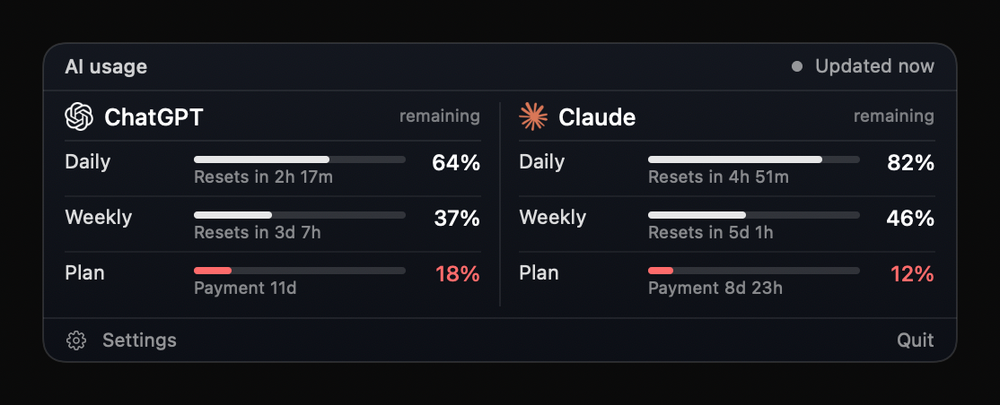

# AI Usage

A compact macOS widget that shows how much of your **ChatGPT** and **Claude** limits you have left: daily window, weekly window, and time until your next subscription payment.



**Languages:** English, Русский, Español, 中文, Deutsch (switch in the menu or in Settings).

## Features

- Dark, compact card with a progress bar per limit; turns red at 20% or less
- Desktop widget, menu bar icon (click to open), and a **notch pop-up** on Macs with a notch (hover; Liquid Glass on macOS 26)
- Pick which AI services to show; services you aren't signed in to are hidden automatically
- Auto-refresh (1 / 5 / 15 / 30 min or manual), refresh on wake, one-click manual refresh
- Launch at login

## Install

1. Download `AIUsage.zip` from [Releases](../../releases/latest), unzip, and move `AIUsage.app` to **Applications**.
2. The app isn't notarized, so the first time: right-click → **Open** → **Open**. If macOS says it is "damaged":
   ```bash
   xattr -dr com.apple.quarantine /Applications/AIUsage.app
   ```

Requires macOS 13 or later.

## How it gets the data

There is no password or API key to enter. The app reuses logins that already exist on your Mac:

| Service | Source | Sign in with |
|---|---|---|
| ChatGPT | Codex CLI login (`~/.codex/auth.json`) | `codex login` |
| Claude | Claude Code login (macOS Keychain) | `claude`, then `/login` |

It then asks the same endpoints those tools use for rate-limit usage. Tokens stay on your Mac and are only sent to `chatgpt.com` and `api.anthropic.com`. Claude's access token lasts about 8 hours; the app renews it with the refresh token (only while Claude Code isn't running) and writes the new token back to the Keychain.

> **Unofficial.** This project is not affiliated with or endorsed by OpenAI or Anthropic. The usage endpoints are undocumented and can change or stop working at any time. Using them may be against the services' terms; use at your own risk. The "Billing" row is an estimate based on your subscription start date, not data from the payment provider.

Other services (Gemini, GitHub Copilot, …) can be added in `Sources/AIUsage/Services.swift` + `Providers.swift` once a usage source is available.

## Build from source

```bash
git clone https://github.com/gudisigor/ai-usage-widget.git
cd ai-usage-widget
./build.sh && open AIUsage.app      # or ./package.sh for dist/AIUsage.zip
```

Needs the Swift toolchain (Xcode Command Line Tools). `--demo` launches with sample data.

## Trademarks

ChatGPT / OpenAI and Claude / Anthropic names and logos belong to their owners and are used only to identify the services. Logos come from [Simple Icons](https://simpleicons.org).

## License

MIT
